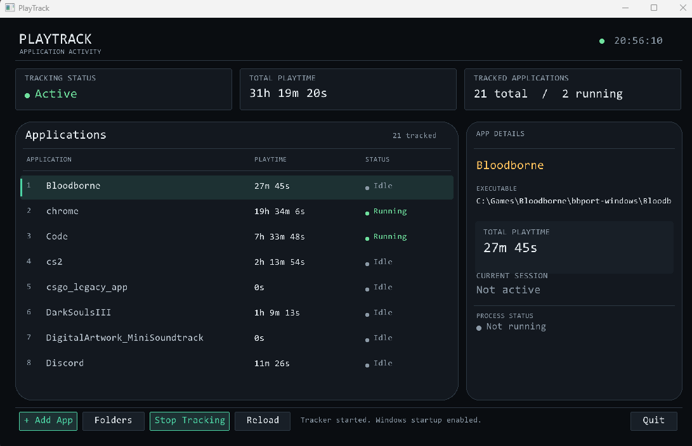
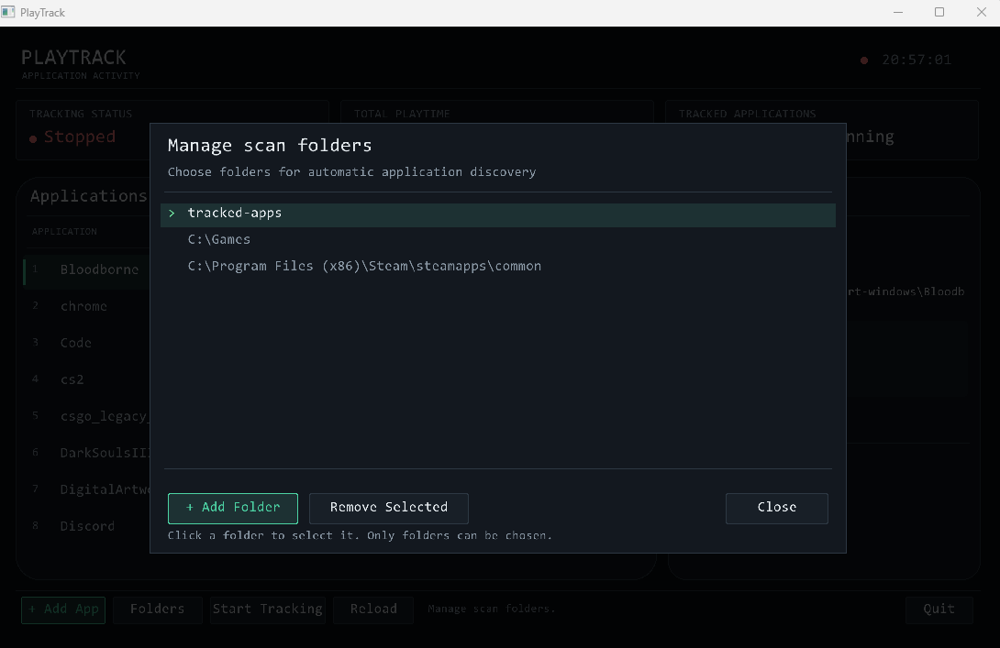
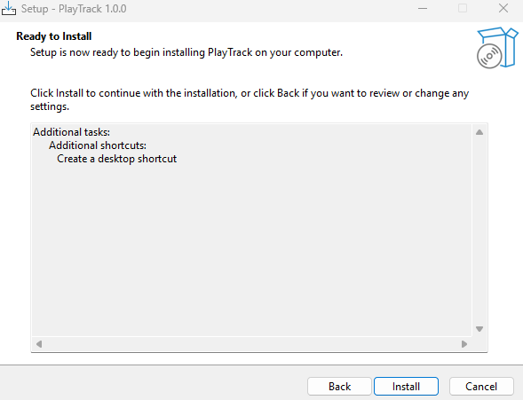

# PlayTrack

**A lightweight Windows application and game playtime tracker built with C++17 and Raylib.**

PlayTrack tracks time spent in selected Windows applications and games through a desktop dashboard and background tracking system.

[**Download PlayTrack v1.0.0**](https://github.com/adityabhandekar77-dev/PlayTrack/releases/tag/v1.0.0)

## Screenshots

### Dashboard and Live Tracking

View tracked applications, total playtime, running status, and individual application details.

### Scan Folder Management

Choose folders for automatic application discovery and manage the directories PlayTrack scans.

### Windows Installer

Install PlayTrack using the Windows setup wizard.

## Features

- **Application Tracking** — Record time spent in selected Windows applications and games.
- **Automatic Process Detection** — Detect running applications and update their tracked time.
- **Background Tracking** — Run the tracker separately from the dashboard.
- **Persistent Playtime Records** — Save accumulated playtime locally.
- **Desktop Dashboard** — View tracked applications, playtime totals, and process status.
- **Scan Folder Management** — Choose folders for automatic application discovery.
- **Windows Startup Integration** — Support automatic tracker startup when signing in to Windows.
- **Standalone Installer** — Install PlayTrack without setting up the development toolchain.

## Installation

1. Visit the [PlayTrack v1.0.0 Releases page](https://github.com/adityabhandekar77-dev/PlayTrack/releases/tag/v1.0.0).
2. Download `PlayTrack-Setup-1.0.0.exe` from the release assets.
3. Run the installer and follow the setup instructions.
4. Launch PlayTrack from the Start Menu or desktop shortcut.

PlayTrack stores its configuration and playtime data locally under your Windows Local AppData directory.

## Technology Stack

- **C++17** — Application logic
- **Raylib** — Graphical interface
- **Windows API** — Process detection and Windows integration
- **CMake** — Build configuration
- **MSYS2 UCRT64** — Development toolchain
- **nlohmann/json** — Local data persistence
- **Inno Setup** — Windows installer

## Project Status

**Latest release: v1.0.0**

The first public Windows release is available. PlayTrack has been tested on the developer's PC and an additional Windows laptop. Further testing and user feedback will help guide future improvements.

## Feedback

Found a bug or have a suggestion? Open an issue in this repository and include details about the problem or improvement.

---

Built with C++ and a love for tracking playtime.